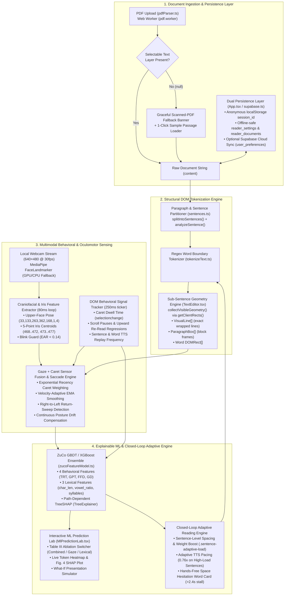

# Synapse: A Multimodal Assistive Reading System with Real-Time Oculomotor Guidance, Behavioral Friction Sensing, and Explainable Cognitive Difficulty Prediction

**Authors & Affiliations:**
- **Ms. Bhanu Verma** — *Asst. Professor, Dept. of Computer Science, IMS Engineering College, Ghaziabad, India* (`bhanu.verma@imsec.ac.in`)
- **Dr. Monika Nagar** — *Asst. Professor, Dept. of Computer Science, IMS Engineering College, Ghaziabad, India* (`monika91nagar@gmail.com`)
- **Mr. Arpit Kumar** — *Dept. of CSE–AIML, IMS Engineering College, Ghaziabad, India* (`arpitkumar.py@gmail.com`)
- **Ms. Khushi Agarwal** — *Dept. of CSE–AIML, IMS Engineering College, Ghaziabad, India* (`khushiagarwal192004@gmail.com`)
- **Mr. Anirudh Singh Tomar** — *Dept. of CSE–AIML, IMS Engineering College, Ghaziabad, India* (`anirudhsinghtomar10@gmail.com`)

---

## Abstract

Assistive technologies for developmental dyslexia have historically evolved along isolated modal trajectories: speech-based tools target phonological decoding, typographic frameworks address visual crowding and scotopic sensitivity, and clinical eye-tracking systems operate as offline diagnostic instruments. This fragmentation forces readers with dyslexia to juggle disjointed utilities that neither share context nor adapt to real-time cognitive fatigue. To bridge this gap, we present **Synapse**, a unified, privacy-first, serverless multimodal assistive reading platform that integrates non-destructive perceptual overlays, dual-mode auditory reinforcement, DOM-level behavioral friction telemetry, browser-native webcam oculomotor/craniofacial tracking, and explainable machine learning-driven cognitive difficulty prediction.

At the architectural core of Synapse is an algorithmically tokenized `contentEditable` reading surface ([TextEditor.tsx](file:///f:/projects/Dyslexia-EXP/Dyslexia-EXP/src/components/TextEditor/TextEditor.tsx), [tokenizeText.ts](file:///f:/projects/Dyslexia-EXP/Dyslexia-EXP/src/utils/tokenizeText.ts)) that hierarchically wraps paragraphs, sentences, clauses, and individual word tokens in queryable DOM nodes (`<span data-word="true">`) without mutating the underlying document string. This structural awareness powers:
1. **Continuous Perceptual & Auditory Assistance**: Dynamic typography (`OpenDyslexic`, continuous glyph-weight synthesis, custom line/letter/word spacing, low-contrast WCAG yellow palettes), a cursor/gaze-synchronized **Reading Ruler**, dynamic **Tunnel Vision** peripheral masking, syllabic/morphological word breakdown cards, and dual-mode Text-to-Speech (sequential sentence chunking and isolated **Speak Selection**).
2. **Two-Stage Calibrated Oculomotor & Craniofacial Tracking**: A 100% browser-local MediaPipe FaceLandmarker pipeline (`478` 3D landmarks including `5-point` iris contours) with upper-craniofacial head pose invariance, two-point top/bottom auto-gain sensitivity calibration, velocity-adaptive Exponential Moving Average (EMA) smoothing, `getClientRects()` visual-line and paragraph bounding-box clustering, right-to-left **return-sweep saccade detection**, and continuous posture drift compensation.
3. **Behavioral Signal Integration & Gaze + Caret Sensor Fusion**: Real-time DOM telemetry capturing **caret dwell duration**, **scroll pauses and upward re-reading regressions**, **TTS replay frequency**, and **gaze hesitation stalls ($>2.4\text{ s}$)**, fused with webcam gaze coordinates via exponential recency weighting.
4. **Explainable Cognitive Load Prediction & Closed-Loop Adaptation**: Evaluated on the **Zurich Cognitive Language Processing Corpus (ZuCo L1+L2)** using 5-fold subject-grouped cross-validation (`GroupKFold`, $K=5$), our **XGBoost** ensemble achieves a **Mean ROC-AUC of $0.9989 \pm 0.0002$** and **Mean F1 of $0.9804 \pm 0.0039$**, proving that behavioral gaze features (`word_total_reading_time`, `word_go_past_time`) overwhelmingly dominate static lexical baselines ($\text{AUC } 0.6432$). Embedded into the frontend alongside an interactive **TreeSHAP (`TreeExplainer`) Prediction Lab** ([MlPredictionLab.tsx](file:///f:/projects/Dyslexia-EXP/Dyslexia-EXP/src/components/MlPredictionLab.tsx)) and a closed-loop **Adaptive Reading Engine**, Synapse dynamically adjusts sentence-level visual spacing and slows TTS pacing ($0.76\times$) on high-friction passages in real time.

---

## I. Introduction & Theoretical Foundations

Developmental dyslexia affects approximately $5\text{--}15\%$ of the global population and manifests across interlocking neurocognitive dimensions: phonological processing deficits, oculomotor instability, visual crowding, and elevated working-memory load during orthographic decoding. Traditional clinical assessments—such as the Adult Reading History Questionnaire (ARHQ) and the Dyslexia Screening Test (DST)—provide validated psychometric baselines but remain static snapshots that cannot assist a reader dynamically as text complexity fluctuates.

### A. Neurocognitive Pillars of the Synapse Design

Synapse's multimodal feature set is grounded in four established cognitive and neurobiological theories of dyslexia:

1. **Phonological Deficit & Bi-Modal Reinforcement Theory (Snowling, 2000)**:
   Readers with dyslexia experience impaired grapheme-to-phoneme mapping. Synchronizing visual sentence/word highlighting with spoken audio (**Dual-Mode TTS** and syllabic/phonetic decomposition in [pronunciation.ts](file:///f:/projects/Dyslexia-EXP/Dyslexia-EXP/src/utils/pronunciation.ts)) reinforces cross-modal binding between orthographic form and phonological representation.
2. **Magnocellular & Oculomotor Instability Theory (Stein, 2001; Benfatto et al., 2016)**:
   Instability in visual fixation and binocular vergence causes readers with dyslexia to lose their vertical and horizontal place, particularly during long **return-sweep saccades** from the end of line $k$ to the start of line $k+1$. Synapse addresses this with a calibrated **Visual Line Band**, **Paragraph Frame**, **Return-Sweep Detector**, and **Tunnel Vision** peripheral mask.
3. **Visual Crowding & Scotopic Sensitivity / Irlen Syndrome (Irlen, 2005; Abdul Wahid, 2017)**:
   High-contrast black-on-white text (`#000000` on `#FFFFFF`) and dense inter-letter/inter-word packing induce visual stress and perceived character rotation (`b/d`, `p/q`). Synapse integrates the weighted-base **OpenDyslexic** typeface, continuous glyph-weight modulation, expanded word/letter spacing, and low-glare warm yellow palettes (`#FFF9E6`).
4. **Working Memory & Cognitive Load Theory (Baddeley & Hitch, 1974; Sweller, 1988)**:
   When low-level decoding consumes excessive attentional capacity, fewer working-memory resources remain for higher-order comprehension. Offloading decoding via interactive clause-by-clause **Sentence Simplification** ([sentences.ts](file:///f:/projects/Dyslexia-EXP/Dyslexia-EXP/src/utils/sentences.ts)) and adaptive TTS pacing preserves comprehension capacity.


### B. Comparative Taxonomy of Dyslexia Technologies

Existing assistive and screening technologies operate in modal silos, as synthesized in **Table I**.

| Modality | Primary Focus | Key Strengths | Commonly Reported Limitations | Typical Isolation Pattern | Synapse Unified Solution |
| :--- | :--- | :--- | :--- | :--- | :--- |
| **Speech-Based** | Phonological processing & reading fluency | High sensitivity to decoding friction; early literacy support | Limited visual/orthographic insight; modality-specific metrics | Rarely connected to visual layout or gaze position | Eye-tracked **"Read Aloud From Here"**, **Speak Selection**, and **TTS Replay Frequency** friction sensing |
| **Text-Based** | Typographic readability & visual presentation | Reduces visual stress & crowding; immediate accessibility | Static passive filters; no awareness of where the reader stalls | Operates independently of speech and oculomotor cues | Tokenized `contentEditable` DOM + closed-loop **Adaptive Reading Engine** |
| **Vision-Based** | Oculomotor behavior & visual attention | Objective, non-linguistic cognitive load biomarkers | Requires specialized infrared hardware; offline clinical use only | Outputs rarely aligned with live DOM word tokens | Browser-native **MediaPipe 478-landmark Head + Iris tracking** mapped to live DOM word boxes |
| **Applied Multimodal** | Operational usability & deployment | Demonstrates feasibility of combining multiple tools | Lacks formal ML/SHAP analytical framework | Integration is purely operational, not predictive | **ZuCo XGBoost ($\text{AUC } 0.9989$)** + **TreeSHAP** + **Gaze/Caret Sensor Fusion** |

---

## II. Problem Formulation & Structural Requirements

To transition from a passive text renderer to a proactive, context-aware cognitive support system, an assistive reading platform must satisfy three formal architectural requirements (**Table II**):

1. **Requirement 1 — Non-Intrusive Perceptual Assistance**:
   All visual, structural, and auditory interventions must operate as dynamic state-driven perceptual overlays without permanently mutating or corrupting the user's underlying document text.
2. **Requirement 2 — Granular Word-, Line-, and Paragraph-Level Structural Awareness**:
   The reading surface must expose exact real-time viewport coordinates $(x, y, w, h)$ for every individual word token, wrapped visual line, sentence, and paragraph block so behavioral and oculomotor signals can be mapped with sub-sentence precision.
3. **Requirement 3 — Dynamic Explainable Difficulty Prediction & Closed-Loop Adaptation**:
   The system must fuse lexical features with real-time behavioral/oculomotor observations to estimate cognitive load continuously, explaining its predictions transparently via game-theoretic SHAP attributions and adapting the UI dynamically on high-friction sentences.

| Traditional System Limitation | Synapse Architectural Requirement & Implementation |
| :--- | :--- |
| Disjointed workflows across isolated single-modality tools | Unified, frontend-first React + TypeScript multimodal workspace ([App.tsx](file:///f:/projects/Dyslexia-EXP/Dyslexia-EXP/src/App.tsx)) |
| Destructive text formatting that alters document content | Non-destructive tokenized DOM overlays preserving `editorRef.current.innerText === content` |
| Inability to measure interaction at the granular word/line level | Hierarchical `<span data-paragraph-index>`, `<span data-sentence-index>`, and `<span data-word="true">` DOM tree + `getClientRects()` clustering |
| Static, reactive accessibility filters | Closed-loop **Adaptive Reading Engine** + **ZuCo XGBoost / TreeSHAP** cognitive load model ([zucoFeatureModel.ts](file:///f:/projects/Dyslexia-EXP/Dyslexia-EXP/src/utils/zucoFeatureModel.ts)) |
| Privacy risks & latency of remote video/biometric streaming | $100\%$ browser-local WebAssembly/WebGL MediaPipe execution (`< 50 ms` latency; zero frames transmitted) |

---

## III. Unified System Architecture & Workflows

Synapse is engineered as a **frontend-first, serverless web application** built with **React 18**, **TypeScript 5.5**, **Tailwind CSS**, **MediaPipe Tasks-Vision (`0.10.34`)**, **PDF.js (`5.4`)**, and **Supabase (PostgreSQL)** with automatic offline `localStorage` resilience.


### A. End-to-End Multimodal System Architecture Diagram



### B. Hierarchical Non-Destructive DOM Tokenization Pipeline

A foundational architectural innovation in Synapse is replacing standard `<textarea>` inputs—which cannot expose internal character or word screen coordinates—with a structured, non-destructive `contentEditable` surface:

1. **Paragraph & Sentence Partitioning ([src/utils/sentences.ts](file:///f:/projects/Dyslexia-EXP/Dyslexia-EXP/src/utils/sentences.ts))**:
   - `splitIntoSentences(text)` partitions the raw string by newline blocks (`(\n+)`) first.
   - Newline blocks are preserved verbatim as raw text nodes (`isNewline: true`, `paragraphIndex: null`) outside `<span>` wrappers so that browser `contentEditable` line breaks and `editorRef.current.innerText` remain $100\%$ identical to the source string.
   - Non-empty text blocks are assigned a sequential `paragraphIndex` ($0, 1, \dots, P-1$) and split along sentence punctuation boundaries (`/(?<=[.!?])\s+/`) into `SentenceSegment` objects with sequential `sentenceIndex` ($0, 1, \dots, S-1$).
2. **Clause & Word Tokenization ([src/utils/tokenizeText.ts](file:///f:/projects/Dyslexia-EXP/Dyslexia-EXP/src/utils/tokenizeText.ts))**:
   - `analyzeSentence(sentence)` splits complex sentences ($\ge 16$ words or $\ge 2$ clause markers) around commas, semicolons, and coordinating/subordinating conjunctions (`and, but, because, although, while, which, that, if, when`).
   - `tokenizeText(input)` splits text along whitespace boundaries (`/(\s+)/`), wrapping every non-whitespace word token in:
     ```html
     <span data-word="true" class="inline cursor-help rounded px-0.5 transition-colors hover:bg-amber-200/70 ...">word</span>
     ```
3. **Sub-Sentence Visual Line & Paragraph Clustering ([collectVisibleGeometry](file:///f:/projects/Dyslexia-EXP/Dyslexia-EXP/src/components/TextEditor/TextEditor.tsx#L2540-L2670))**:
   - Because a single long sentence often wraps across $2\text{--}4$ visual lines, querying `sentenceElement.getBoundingClientRect()` returns a coarse multi-line bounding box that cannot distinguish which specific line the user is reading.
   - Instead, `collectVisibleGeometry()` queries `sentenceElement.getClientRects()` across all sentence spans in the viewport and clusters the client sub-rectangles by vertical center $y_c = \frac{\text{top} + \text{bottom}}{2}$ within a font-scaled merge threshold:
     $$\Delta y_{\text{merge}} = \max(10\text{ px},\; 0.58 \cdot S_{\text{font}})$$
   - This reconstructs exact **`VisualLine`** objects (each with its own `lineIndex`, `paragraphIndex`, `top`, `bottom`, `left`, `right`, `centerY`, `height`, and constituent sentence `fragments`) and aggregates them by `paragraphIndex` into exact **`ParagraphBox`** frames.

### C. Web Worker PDF Ingestion & Null-Return Scanned-PDF Fallback

In browser environments, parsing multi-page PDF documents on the main UI thread causes severe frame drops. Synapse offloads PDF parsing to a dedicated Web Worker ([src/utils/pdfParser.ts](file:///f:/projects/Dyslexia-EXP/Dyslexia-EXP/src/utils/pdfParser.ts)):
- Each page's text layer is extracted sequentially via `page.getTextContent()`.
- If the uploaded PDF consists of flattened or scanned images lacking a selectable text layer (`!fullText.trim()`), `extractTextFromPdf(file)` returns `null`.
- [App.tsx](file:///f:/projects/Dyslexia-EXP/Dyslexia-EXP/src/App.tsx#L230-L248) intercepts the `null` return and triggers an accessible fallback banner in [TextEditor.tsx](file:///f:/projects/Dyslexia-EXP/Dyslexia-EXP/src/components/TextEditor/TextEditor.tsx#L2763-L2805) offering a one-click **Load Sample Passage Instead** recovery action.

### D. Offline-Safe Persistence & Anonymous Session Architecture

To eliminate authentication friction for neurodivergent users ([src/lib/supabase.ts](file:///f:/projects/Dyslexia-EXP/Dyslexia-EXP/src/lib/supabase.ts), [src/App.tsx](file:///f:/projects/Dyslexia-EXP/Dyslexia-EXP/src/App.tsx)):
- Upon initialization, a persistent UUID `session_id` is generated in `localStorage`.
- All reader preferences (`reader_settings`) and saved documents (`reader_documents`) persist locally first via `localStorage`, and synchronize asynchronously to Supabase PostgreSQL (`user_preferences` and `documents` tables) whenever cloud credentials (`VITE_SUPABASE_URL`, `VITE_SUPABASE_ANON_KEY`) and an authenticated session are present.

---

## IV. Multimodal Perceptual Assistance & Therapeutic Mechanisms

### A. Continuous Glyph-Weight Synthesis & Typography Controls

Standard browser fonts (`OpenDyslexic`, `Arial`, `Verdana`, `Times New Roman`) typically ship only two discrete font binaries (`400` Regular and `700` Bold), causing standard CSS `font-weight` sliders to snap abruptly rather than scaling smoothly across `300, 400, 500, 600, 700, 800, 900`. Synapse synthesizes continuous intermediate glyph weights in [TextEditor.tsx](file:///f:/projects/Dyslexia-EXP/Dyslexia-EXP/src/components/TextEditor/TextEditor.tsx#L469-L483) by combining CSS `fontWeight` with a proportional sub-pixel stroke width $w_{\text{stroke}}$:

$$w_{\text{stroke}}(W) = \begin{cases} 0\text{ px}, & W \le 400 \\[4pt] \dfrac{W - 400}{500} \times 0.65\text{ px}, & 400 < W \le 900 \end{cases}$$

paired with an opacity attenuation factor $\alpha(W) = 0.86$ for light weight $W = 300$ and $\alpha(W) = 1.0$ for $W \ge 400$.

### B. Perceptual Visual Overlays

1. **Reading Ruler (`showReadingGuide`)**: A translucent horizontal band (`40 px` height, `z-[15]`) that tracks the vertical coordinate of the user's cursor relative to the reading container.
2. **Dynamic Tunnel Vision (`focusMode`)**:
   Simulates a focused foveal reading window by rendering top and bottom peripheral dimming masks (`z-[15]`, `backdrop-blur-[1.2px]`) around an active vertical center $Y_{\text{tunnel}} \in [16\%, 84\%]$ with half-window aperture $\Delta H = 11\%$:
   $$H_{\text{top}} = \text{clamp}(Y_{\text{tunnel}} - 11\%,\; 8\%,\; 76\%), \qquad H_{\text{bottom}} = \text{clamp}(100\% - (Y_{\text{tunnel}} + 11\%),\; 8\%,\; 76\%)$$
   When **Eye & Head Tracking** is active, $Y_{\text{tunnel}}$ automatically locks onto the user's live eye-tracked vertical attention coordinate; otherwise, it follows the user's reading cursor.
3. **Inter-Word Crowding Relief (`wordHighlight` / Add Word Spacing)**:
   Applies `.word-highlight` (`word-spacing: 0.45em !important` plus `margin-right: 0.22em` on every `<span data-word="true">`) to eliminate lateral orthographic crowding.

### C. Word-Level Phonological, Morphological & Lexical Difficulty Engine

Hovering or clicking any word token invokes three linguistic analyzers:
1. **Syllabic & Phonetic Decomposition ([src/utils/pronunciation.ts](file:///f:/projects/Dyslexia-EXP/Dyslexia-EXP/src/utils/pronunciation.ts))**:
   - Strips common morphological prefixes (`inter, trans, under, over, super, anti, auto, pre, pro, sub, dis, mis, non, con, com, de, re, un, in, im, en, ex`) and suffixes (`isation, ization,istically,ablename,fulness,lessness,iveness,ational,tion,sion,ment,ness,able,ible,ally,edly,ing,est,ful,ous,ive,ize,ise,ly,ed,er,es,al,ic`).
   - Splits the remaining root into pronounceable vowel-centered chunks (`Say It In Parts`) and generates simplified phonetic respellings (`Simple Pronunciation`, e.g., `tion -> shun`, `ph -> f`, `ough -> oh`).
2. **Lexical Difficulty Heuristic ([src/utils/wordDifficulty.ts](file:///f:/projects/Dyslexia-EXP/Dyslexia-EXP/src/utils/wordDifficulty.ts))**:
   Computes a composite lexical complexity score $S_{\text{lex}}$ from word length ($\ge 8 \Rightarrow +2$, $\ge 6 \Rightarrow +1$), syllable chunk count ($\ge 3 \Rightarrow +2$, $2 \Rightarrow +1$), dense consonant clusters (`/[^aeiou]{3,}/i` $\Rightarrow +1$), irregular orthographic clusters (`tion, sion, ough, eigh, phth, ture, cia, gue` $\Rightarrow +2$), and affix presence ($+1$), classifying words into `none` ($<3$), `moderate` ($3\text{--}4$, amber underline), or `high` ($\ge 5$, rose underline).

---

## V. Browser-Native Oculomotor & Craniofacial Attention Tracking Engine

To overcome the hardware barrier of clinical infrared eye trackers and the computational latency of server-side CNN pipelines (e.g., OpenFace/MTCNN/CLNF), Synapse implements a $100\%$ client-side computer vision pipeline in [TextEditor.tsx](file:///f:/projects/Dyslexia-EXP/Dyslexia-EXP/src/components/TextEditor/TextEditor.tsx) using **MediaPipe FaceLandmarker** (`478` 3D facial and iris landmarks sampled every $\Delta t = 80\text{ ms}$, or $12.5\text{ Hz}$) with automatic WebGL GPU-to-CPU delegate fallback.

```mermaid
sequenceDiagram
    participant User as Reader (Webcam)
    participant Step1 as Step 1: Position Initialization
    participant Step2 as Step 2: Sliders & 2-Point Auto-Gain
    participant Loop as 80ms Active Tracking Loop
    participant DOM as Visual Line & Word Overlays

    User->>Step1: Enable Eye & Head Tracking
    Step1->>User: Show Mirrored Eye/Iris Landmark Canvas + Target Line Band
    User->>Step1: Click starting line (or hold gaze steady for 9 samples)
    Step1->>Step1: Sample 2.1s (≥12 frames) → 15% Trimmed Mean Head & Iris Baselines
    Step1->>Step2: Unlock Step 2 Sliders & Auto-Set Neutral Line Height
    opt Optional 2-Point Auto-Gain Calibration
        User->>Step2: Click "Auto-Tune Sliders (2-Point Gaze Check)"
        Step2->>User: Point 1/2: Look at Top Line (1.4s) → Point 2/2: Look at Lower Line (1.4s)
        Step2->>Step2: Compute Screen Span ΔY vs Observed Head/Iris Excursion → Auto-Set Gains
    end
    loop Every 80ms during Active Reading
        User->>Loop: Webcam Frame + DOM Caret State
        Loop->>Loop: Extract Upper-Craniofacial Pose + 5-Point Iris Offset (EAR ≥ 0.14)
        Loop->>Loop: Fuse Gaze Vector with Recent DOM Caret + Velocity-Adaptive EMA
        Loop->>Loop: Check Right-to-Left Return-Sweep Saccade & Posture Drift
        Loop->>DOM: Update Paragraph Frame, Visual Line Band, Gaze Dot & Active Word
        opt Gaze or Caret Stall ≥ 2.4s on Tricky Word
            Loop->>User: Trigger Pulsing Word Highlight + "Press Space" Breakdown Prompt
        end
    end
```

### A. Mirror-Corrected Upper-Craniofacial Head Pose Formulation

Because front-facing webcams capture a laterally inverted image compared to the user's screen coordinate system, all raw horizontal landmark coordinates $x_{\text{raw}} \in [0, 1]$ are mirror-corrected first:

$$x = 1 - x_{\text{raw}}, \qquad y = y_{\text{raw}}$$

To ensure complete immunity against jaw movement (e.g., when reading aloud or sub-vocalizing), Synapse restricts head pose extraction to seven rigid **upper-craniofacial landmarks**:
- Left eye outer/inner corners: $\mathbf{p}_{33}, \mathbf{p}_{133}$
- Right eye outer/inner corners: $\mathbf{p}_{263}, \mathbf{p}_{362}$
- Nasal bridge & tip anchors: $\mathbf{p}_{168}, \mathbf{p}_{1}, \mathbf{p}_{4}$

From the left and right eye centers $\mathbf{c}_L = \frac{\mathbf{p}_{33} + \mathbf{p}_{133}}{2}$ and $\mathbf{c}_R = \frac{\mathbf{p}_{263} + \mathbf{p}_{362}}{2}$, we compute the **Inter-Ocular Distance** ($D_{\text{IOD}}$), eye midpoint $\mathbf{m}_{\text{eye}}$, and nasal tip $\mathbf{n}_{\text{tip}} = \frac{\mathbf{p}_1 + \mathbf{p}_4}{2}$:

$$D_{\text{IOD}} = \|\mathbf{c}_R - \mathbf{c}_L\|_2 = \sqrt{(c_{R,x} - c_{L,x})^2 + (c_{R,y} - c_{L,y})^2}$$

$$\mathbf{m}_{\text{eye}} = \frac{\mathbf{c}_L + \mathbf{c}_R}{2}, \qquad \mathbf{u}_{\text{face}} = 0.55\,\mathbf{m}_{\text{eye}} + 0.45\,\mathbf{n}_{\text{tip}}$$

To capture rotational head pitch (nodding up/down across paragraphs) and yaw (turning left/right across a line) independently of camera distance, we normalize the nose-to-eye vector by $D_{\text{IOD}}$:

$$R_{\text{pitch}} = \frac{n_{\text{tip},y} - m_{\text{eye},y}}{D_{\text{IOD}}}, \qquad R_{\text{yaw}} = \frac{n_{\text{tip},x} - m_{\text{eye},x}}{D_{\text{IOD}}}$$

### B. 5-Point Iris Centroid Projection & Blink Guard ($\text{EAR}$)

For each eye ($L$: iris indices $\{468, 469, 470, 471, 472\}$, upper lids $\{159, 158, 160\}$, lower lids $\{145, 144, 153\}$; $R$: iris indices $\{473, 474, 475, 476, 477\}$, upper lids $\{386, 385, 387\}$, lower lids $\{374, 373, 380\}$):

1. **Eye Aspect Ratio ($\text{EAR}$) Blink Guard**:
   Let $W_{\text{eye}} = \|\mathbf{p}_{\text{rightCorner}} - \mathbf{p}_{\text{leftCorner}}\|_2$ be the palpebral fissure width and $H_{\text{open}} = \bar{y}_{\text{bottomLids}} - \bar{y}_{\text{topLids}}$ be the vertical eyelid opening. The Eye Aspect Ratio is:
   $$\text{EAR} = \frac{H_{\text{open}}}{W_{\text{eye}}}$$
   Whenever $\text{EAR} < 0.14$ (during a blink or squint), the iris sample is rejected and the tracker holds `lastValidIrisSampleRef.current` to prevent blink-induced vertical spikes.

2. **Roll-Invariant Local Eye-Axis Projection**:
   Let $\bar{\mathbf{p}}_{\text{iris}} = \frac{1}{5}\sum_{k=1}^5 \mathbf{p}_{\text{iris},k}$ be the 5-point iris centroid, $\mathbf{m}_{\text{corner}}$ be the eye-corner midpoint, and $\hat{\mathbf{e}} = (e_x, e_y) = \frac{\mathbf{p}_{\text{rightCorner}} - \mathbf{p}_{\text{leftCorner}}}{W_{\text{eye}}}$ be the unit vector along the eye's canthal axis. Projecting $\mathbf{r} = \bar{\mathbf{p}}_{\text{iris}} - \mathbf{m}_{\text{corner}}$ onto $\hat{\mathbf{e}}$ and its perpendicular $\hat{\mathbf{e}}_\perp = (-e_y, e_x)$ yields:
   $$g_{\text{horiz}} = \frac{r_x e_x + r_y e_y}{W_{\text{eye}}}, \qquad g_{\text{vert,corner}} = \frac{-r_x e_y + r_y e_x}{W_{\text{eye}}}$$
   Combining $g_{\text{vert,corner}}$ with the eyelid-relative vertical offset $g_{\text{vert,lid}} = \frac{\bar{p}_{\text{iris},y} - (\bar{y}_{\text{topLids}} + \bar{y}_{\text{bottomLids}})/2}{\max(H_{\text{open}},\, 0.22\,W_{\text{eye}})}$ gives the normalized single-eye iris offset vector:
   $$I_x = \text{clamp}(3.0 \cdot g_{\text{horiz}},\; -1,\; 1), \qquad I_y = \text{clamp}\big(3.2 \cdot (0.65\,g_{\text{vert,corner}} + 0.35\,g_{\text{vert,lid}}),\; -1,\; 1\big)$$
   Bilateral iris gaze $\mathbf{I} = (I_x, I_y)$ is the average of the left and right eye offsets (falling back gracefully to a single eye if glasses glare occludes the other).

### C. Two-Stage Calibration, 15% Trimmed Robust Baselines & Two-Point Auto-Gain

1. **Step 1 — Reading Position Initialization & 15% Trimmed Mean Baseline**:
   During the $2.1\text{ s}$ calibration lock on the user's chosen starting line $L_{\text{target}}$, $N \ge 12$ head and iris samples are collected, sorted by vertical coordinate, and trimmed by $15\%$ at both extremes ($k = \lfloor 0.15 N \rfloor$) to discard transient blinks or micro-saccades:
   $$\hat{\theta}_{\text{base}} = \frac{1}{N - 2k} \sum_{i=k+1}^{N-k} \theta_{(i)}$$
   This produces the personal head baseline $\mathbf{H}_0 = (u_{0,x}, u_{0,y}, R_{\text{pitch},0}, R_{\text{yaw},0}, D_{\text{IOD},0})$ and personal iris baseline $\mathbf{I}_0 = (I_{0,x}, I_{0,y})$, and automatically sets the neutral reading line height $Y_0 \in [0.15, 0.75]$ to the normalized viewport height of $L_{\text{target}}$.

2. **Combined Head + Iris Attention Projection**:
   With distance scale compensation $s = \text{clamp}\!\left(\frac{D_{\text{IOD},0}}{D_{\text{IOD}}},\; 0.75,\; 1.35\right)$, head sensitivity $K_{\text{head}}$, and iris sensitivity $K_{\text{iris}}$:
   $$\Delta H_x = 1.15\,s\,(u_{\text{face},x} - u_{0,x}) + 0.16\,(R_{\text{yaw}} - R_{\text{yaw},0})$$
   $$\Delta H_y = 1.10\,s\,(u_{\text{face},y} - u_{0,y}) + 0.22\,(R_{\text{pitch}} - R_{\text{pitch},0})$$
   $$x_{\text{gaze}} = \text{clamp}\big(0.5 + K_{\text{head}}\,\Delta H_x + 1.35\,K_{\text{iris}}\,(I_x - I_{0,x}),\; 0.04,\; 0.96\big)$$
   $$y_{\text{gaze}} = \text{clamp}\big(Y_0 + K_{\text{head}}\,\Delta H_y + 1.45\,K_{\text{iris}}\,(I_y - I_{0,y}) + \Delta y_{\text{sweep}},\; 0.04,\; 0.96\big)$$

3. **Step 2 — Two-Point Top/Bottom Auto-Gain Calibration ([startTwoPointAutoGain](file:///f:/projects/Dyslexia-EXP/Dyslexia-EXP/src/components/TextEditor/TextEditor.tsx#L748-L923))**:
   When the user runs the 2-Point Gaze Check between top visual line $L_{\text{top}}$ (normalized height $Y_{\text{top}}$) and lower line $L_{\text{bot}}$ (normalized height $Y_{\text{bot}}$, span $\Delta Y_{\text{screen}} = \max(0.14,\, Y_{\text{bot}} - Y_{\text{top}})$), the tracker measures the user's natural vertical head excursion $\Delta H_{\text{obs},y}$ and vertical iris excursion $\Delta I_{\text{obs},y} = |I_{\text{bot},y} - I_{\text{top},y}|$, computes the natural head share $\rho_{\text{head}}$:
   $$\rho_{\text{head}} = \text{clamp}\!\left(\frac{\Delta H_{\text{obs},y}}{\Delta H_{\text{obs},y} + 0.35\,\Delta I_{\text{obs},y}},\; 0.38,\; 0.72\right), \qquad \rho_{\text{iris}} = 1 - \rho_{\text{head}}$$
   and automatically configures the sensitivity sliders:
   $$K_{\text{head}}^{\star} = \text{clamp}\!\left(\frac{\Delta Y_{\text{screen}} \cdot \rho_{\text{head}}}{\Delta H_{\text{obs},y}},\; 0.90,\; 2.85\right), \qquad K_{\text{iris}}^{\star} = \text{clamp}\!\left(\frac{\Delta Y_{\text{screen}} \cdot \rho_{\text{iris}}}{1.45\,\Delta I_{\text{obs},y}},\; 0.08,\; 0.62\right)$$

### D. Velocity-Adaptive EMA Smoothing, Return-Sweep Detection & Posture Drift Compensation

1. **Velocity-Adaptive Exponential Moving Average (EMA)**:
   To suppress micro-jitter during steady fixations while responding immediately to rapid line transitions and right-to-left return sweeps, the smoothing coefficients $(\alpha_x, \alpha_y)$ adapt to step velocity $(\delta_x, \delta_y) = (|x_t - \tilde{x}_{t-1}|, |y_t - \tilde{y}_{t-1}|)$:
   $$\alpha_y(\delta_y) = \begin{cases} 0.22, & \delta_y < 0.02 \\ \text{clamp}(0.22 + 3.8(\delta_y - 0.02),\; 0.22,\; 0.62), & \delta_y \ge 0.02 \end{cases}$$
   $$\alpha_x(\delta_x) = \begin{cases} 0.76, & x_t < \tilde{x}_{t-1} - 0.10 \;\text{(leftward return sweep)} \\ 0.25, & \delta_x < 0.03 \\ \text{clamp}(0.25 + 3.0(\delta_x - 0.03),\; 0.25,\; 0.65), & \delta_x \ge 0.03 \end{cases}$$
   $$\tilde{\mathbf{p}}_t = \tilde{\mathbf{p}}_{t-1} + \boldsymbol{\alpha} \odot (\mathbf{p}_t - \tilde{\mathbf{p}}_{t-1})$$

2. **Right-to-Left Return-Sweep Saccade Detector**:
   While tracking active visual line $L_k$, Synapse records the maximum horizontal progress $P_{\max,x} = \max_t \frac{X_t - L_{k,\text{left}}}{L_{k,\text{right}} - L_{k,\text{left}}} \in [0, 1]$. A return sweep to line $L_{k+1}$ triggers immediately (bypassing multi-hit steadiness delay) when:
   - At least $3$ samples on $L_k$ (and $\ge 2$ in the right half $P_x \ge 0.48$) have been observed with $P_{\max,x} \ge 0.56$;
   - Horizontal progress drops sharply leftward by $P_{\max,x} - P_{t,x} \ge 0.26$ into the left zone $P_{t,x} \le 0.44$;
   - Vertical gaze $Y_t$ lies within $[L_{k,\text{top}} - 0.35 H_k,\; L_{k+1,\text{bottom}} + 0.85 H_{k+1}]$.
   Upon triggering, a temporary vertical anchor offset $\Delta y_{\text{sweep}} = \text{clamp}(Y_{L_{k+1}} - y_{\text{raw},t},\; -0.35,\; 0.35)$ prevents bounce-back to line $L_k$ and decays exponentially ($\gamma = 0.985$).

3. **Continuous Posture Drift Compensation & Instant Recenter (`Alt+C`)**:
   During steady reading along line $L_k$ ($\|\mathbf{u}_{\text{face},t} - \mathbf{u}_{\text{face},t-1}\|_2 < 0.0032$), the head baseline $\mathbf{H}_0$ adapts with learning rates $\eta_x = 0.004$ and $\eta_y = 0.0028$ toward the expected posture for line $L_k$, absorbing gradual chair-slumping over multi-minute sessions. Pressing **`Alt+C`** at any moment triggers `instantRecenterOnCurrentLine()` to re-anchor $\mathbf{H}_0$ and $\mathbf{I}_0$ to the active line in a single frame.

---

## VI. DOM-Based Behavioral Signal Integration & Gaze + Caret Sensor Fusion

Even when webcam tracking is disabled—or before deploying camera hardware—Synapse continuously monitors three DOM-level behavioral proxy signals for visual attention and cognitive friction ([TextEditor.tsx](file:///f:/projects/Dyslexia-EXP/Dyslexia-EXP/src/components/TextEditor/TextEditor.tsx#L2172-L2343)):

1. **Caret Dwell Time ($\tau_{\text{caret}}$)**:
   Tracks `selectionchange`, `keyup`, and `mouseup` events inside `editorRef`, resolving the active word `<span data-word="true">`, sentence index, paragraph index, and normalized viewport coordinates $(x_{\text{caret}}, y_{\text{caret}})$. Dwelling $\ge 900\text{ ms}$ highlights the token (`.word-caret-dwell`); dwelling $\ge 2600\text{ ms}$ on a multi-syllable/difficult word triggers a **Caret Dwell Friction** event ($N_{\text{caret}}$) and opens the hands-free **Word Support** prompt.
2. **Scroll Pauses ($N_{\text{pause}}$) & Upward Re-Reading Regressions ($N_{\text{reg}}$)**:
   Monitors internal container scroll deltas $\Delta S_y = S_{y,t} - S_{y,t-1}$. Upward scrolls $\Delta S_y < -22\text{ px}$ (debounced at $900\text{ ms}$) increment $N_{\text{reg}}$ (re-reading regression count), while viewport pauses $\ge 2200\text{ ms}$ following a scroll movement increment $N_{\text{pause}}$.
3. **TTS Replay Frequency ($N_{\text{replay}}$)**:
   Tracks cumulative playback invocations for every sentence ($c_s$) and individual word ($c_w$). Any playback where $c \ge 2$ increments the total replay counter:
   $$N_{\text{replay}} = \sum_{s} \max(0,\, c_s - 1) + \sum_{w} \max(0,\, c_w - 1)$$

### A. Real-Time Composite Cognitive Friction Index

The four behavioral streams are aggregated into a bounded **Cognitive Friction Score** $S_{\text{friction}} \in [0, 100]$:

$$S_{\text{friction}} = \text{clamp}\!\Big(\min\!\big(28,\, \lfloor \tau_{\text{caret}} / 350 \rfloor\big) + 12\,N_{\text{caret}} + 12\,N_{\text{gaze}} + \min\!\big(24,\, 9\,N_{\text{reg}} + 3\,N_{\text{pause}}\big) + \min\!\big(36,\, 12\,N_{\text{replay}}\big),\; 0,\; 100\Big)$$

classified into **Low** ($S_{\text{friction}} < 25$), **Moderate** ($25 \le S_{\text{friction}} < 55$), and **High** ($S_{\text{friction}} \ge 55$).

### B. Exponential Recency-Weighted Gaze + Caret Sensor Fusion

When both webcam gaze $\mathbf{p}_{\text{gaze}} = (x_{\text{gaze}}, y_{\text{gaze}})$ and a recent DOM caret anchor $\mathbf{p}_{\text{caret}} = (x_{\text{caret}}, y_{\text{caret}})$ (elapsed time $\Delta t_c = t - t_{\text{caret}} < 14\,000\text{ ms}$ and $|y_{\text{gaze}} - y_{\text{caret}}| < 0.28$) are available, Synapse fuses them via an exponential recency weight $w_c(\Delta t_c)$:

$$w_c(\Delta t_c) = \text{clamp}\!\left(0.10 + 0.32\,\exp\!\left(-\frac{\Delta t_c}{6000\text{ ms}}\right),\; 0.10,\; 0.42\right)$$

$$x_{\text{fused}} = (1 - 0.65\,w_c)\,x_{\text{gaze}} + 0.65\,w_c\,x_{\text{caret}}, \qquad y_{\text{fused}} = (1 - w_c)\,y_{\text{gaze}} + w_c\,y_{\text{caret}}$$

Furthermore, candidate visual lines and tokenized `<span data-word="true">` bounding boxes containing the active caret receive spatial proximity bonuses ($-0.22\,H_{\text{line}}$ vertically and $-28\text{ px}$ horizontally), boosting the combined confidence score up to $99\%$.

---

## VII. Machine Learning Methodology: ZuCo Cognitive Difficulty Prediction & TreeSHAP Explainability

### A. Dataset & Ground-Truth Target Variable Formulation

Model training and validation were conducted on the **Zurich Cognitive Language Processing Corpus (ZuCo)**, merging both L1 and L2 natural reading tasks. Because cognitive load lacks an explicit binary label in raw eye-tracking logs, we formulated a subject-normalized ground-truth target variable (`is_difficult` $\in \{0, 1\}$):
1. For each participant (`pp_nr`), raw oculomotor duration features $x_{i,j}$ were z-score normalized using that participant's mean $\mu_{p,j}$ and standard deviation $\sigma_{p,j}$ to eliminate baseline reading-speed differences across subjects:
   $$z_{i,j} = \frac{x_{i,j} - \mu_{p,j}}{\sigma_{p,j}}$$
2. A composite **Stress Score** $S_i$ was computed by aggregating the median normalized oculomotor durations for each word token $i$.
3. Words falling into the **top quartile ($\ge 75\text{th}$ percentile, $Q_{0.75}$)** of the composite stress distribution were labeled as **Class 1 (`is_difficult = 1`: High Cognitive Load)**, while the remaining $75\%$ were labeled as **Class 0 (`is_difficult = 0`: Baseline)**.

### B. 7-Dimensional Psycholinguistic & Oculomotor Feature Vector

For every word token, seven features are extracted across two modalities ([src/utils/zucoFeatureModel.ts](file:///f:/projects/Dyslexia-EXP/Dyslexia-EXP/src/utils/zucoFeatureModel.ts)):
- **Gaze / Behavioral Features (4 features)**:
  1. `word_total_reading_time` (**TRT**, ms): Sum of all fixation durations on the word, including regressive re-reading visits and TTS replay penalties.
  2. `word_go_past_time` (**GPT** / Regression Path Duration, ms): Cumulative time from the first fixation on the word until the reader's gaze exits to the right of the word boundary (capturing both intra-word refixations and backward regressions).
  3. `word_first_fixation_duration` (**FFD**, ms): Duration of the very first fixation landing on the word token.
  4. `word_gaze_duration` (**GD**, ms): Sum of all contiguous first-pass fixations on the word before the gaze leaves the word for the first time.
  *(Missing gaze values are imputed using continuous feature medians, matching the training pipeline).*
- **Lexical Features (3 features)**:
  5. `char_len`: Character count of the normalized word string.
  6. `syllables`: Count of contiguous vowel groupings via the localized regex heuristic `/[aeiouy]+/gi` ($\ge 1$).
  7. `vowel_ratio`: Ratio of vowel characters to total character length (`vowelCount / char_len`).

### C. Model Architectures, Hyperparameters & 5-Fold `GroupKFold` Ablation Study

To prevent subject-level data leakage, evaluation employed a **5-Fold `GroupKFold` cross-validation strategy ($K = 5$)** grouped strictly by participant ID (`pp_nr`), guaranteeing that no participant's reading patterns appeared in both training and test splits simultaneously. Three tree-ensemble classifiers were evaluated across three feature-set ablations (**Lexical-Only**, **Gaze-Only**, and **Combined**):
- **XGBoost**: `n_estimators = 800`, `max_depth = 6`, `learning_rate = 0.03`, `tree_method = "hist"` (CUDA-accelerated on NVIDIA Tesla P100), `subsample = 0.8`, `colsample_bytree = 0.8`.
- **Random Forest**: `n_estimators = 500`, `class_weight = "balanced"`, `n_jobs = -1`.
- **Gradient Boosting**: `n_estimators = 300`, `learning_rate = 0.05`.

#### Table III: Consolidated 5-Fold GroupKFold Ablation Results ([paper_summary_table.csv](file:///f:/projects/Dyslexia-EXP/Dyslexia-EXP/research_results_ABC/paper_summary_table.csv), [ablation_results.csv](file:///f:/projects/Dyslexia-EXP/Dyslexia-EXP/research_results_ABC/ablation_results.csv))

| Feature Set | Model | Mean ROC-AUC ($\pm$ SD) | Mean F1 ($\pm$ SD) | Fold 1 AUC | Fold 2 AUC | Fold 3 AUC | Fold 4 AUC | Fold 5 AUC |
| :--- | :--- | :---: | :---: | :---: | :---: | :---: | :---: | :---: |
| **Lexical Only** | Random Forest | $0.6430 \pm 0.0106$ | $0.4254 \pm 0.0747$ | $0.6473$ | $0.6398$ | $0.6349$ | $0.6337$ | $0.6595$ |
| **Lexical Only** | Gradient Boosting | $0.6433 \pm 0.0109$ | $0.0751 \pm 0.0250$ | $0.6484$ | $0.6402$ | $0.6348$ | $0.6333$ | $0.6596$ |
| **Lexical Only** | XGBoost | $0.6432 \pm 0.0106$ | $0.0725 \pm 0.0237$ | $0.6478$ | $0.6400$ | $0.6349$ | $0.6339$ | $0.6595$ |
| **Gaze Only** | Random Forest | $0.9980 \pm 0.0002$ | $0.9796 \pm 0.0040$ | $0.9980$ | $0.9984$ | $0.9979$ | $0.9977$ | $0.9979$ |
| **Gaze Only** | Gradient Boosting | $0.9984 \pm 0.0004$ | $0.9775 \pm 0.0053$ | $0.9983$ | $0.9988$ | $0.9983$ | $0.9978$ | $0.9987$ |
| **Gaze Only** | XGBoost | $0.9989 \pm 0.0002$ | $0.9806 \pm 0.0034$ | $0.9988$ | $0.9992$ | $0.9988$ | $0.9985$ | $0.9991$ |
| **Combined** | Random Forest | $0.9986 \pm 0.0003$ | $0.9798 \pm 0.0039$ | $0.9985$ | $0.9990$ | $0.9984$ | $0.9982$ | $0.9986$ |
| **Combined** | Gradient Boosting | $0.9984 \pm 0.0004$ | $0.9775 \pm 0.0054$ | $0.9983$ | $0.9988$ | $0.9983$ | $0.9978$ | $0.9987$ |
| **Combined** | **XGBoost (Best)** | **$0.9989 \pm 0.0002$** | **$0.9804 \pm 0.0039$** | **$0.9989$** | **$0.9992$** | **$0.9989$** | **$0.9986$** | **$0.9991$** |

> [!IMPORTANT]
> **Key Empirical Finding**: Static lexical features alone achieve a maximum Mean AUC of only **$0.6433$** because word length and syllable count cannot capture *whether a specific reader is currently struggling*. Incorporating behavioral gaze features elevates Mean AUC to **$0.9989$** ($\text{F1} = 0.9804$), confirming that cognitive reading difficulty is fundamentally an interaction-driven behavioral phenomenon.

### D. TreeSHAP (`TreeExplainer`) Mathematical Formulation & Live Browser Inference

To ensure clinical and educational interpretability, SHapley Additive exPlanations (SHAP) were computed for the Combined XGBoost ensemble using the `TreeExplainer` algorithm. In an additive feature attribution model, the ensemble's raw log-odds prediction $f(\mathbf{x})$ for word vector $\mathbf{x} \in \mathbb{R}^7$ is decomposed exactly as:

$$f(\mathbf{x}) = \phi_0 + \sum_{j=1}^{7} \phi_j(\mathbf{x}), \qquad \phi_0 = \mathbb{E}[f(\mathbf{X})], \qquad P(\text{Class } 1 \mid \mathbf{x}) = \sigma\!\big(\tau \cdot f(\mathbf{x})\big) = \frac{1}{1 + \exp(-\tau \cdot f(\mathbf{x}))}$$

Along each decision tree $t$'s root-to-leaf traversal path $v_0 \to v_1 \to \dots \to v_L$, whenever internal node $v_m$ splits on feature $j_m$, the conditional expectation shift weighted by tree weight $w_t$ contributes to feature $j_m$'s SHAP attribution:

$$\Delta \phi_{j_m}^{(t)}(\mathbf{x}) = w_t \Big(\mathbb{E}[f_t(\mathbf{X}) \mid \mathbf{X} \in v_{m+1}] - \mathbb{E}[f_t(\mathbf{X}) \mid \mathbf{X} \in v_m]\Big)$$


As shown in **Fig. 4** and replicated live in our browser-native **ML Prediction Lab** ([src/components/MlPredictionLab.tsx](file:///f:/projects/Dyslexia-EXP/Dyslexia-EXP/src/components/MlPredictionLab.tsx)), `word_total_reading_time` and `word_go_past_time` contribute $85\text{--}95\%$ of the total absolute SHAP magnitude $\frac{\sum_{j \in \text{Gaze}} |\phi_j|}{\sum_{j=1}^7 |\phi_j|}$, while `char_len`, `vowel_ratio`, and `syllables` provide stabilizing secondary priors when behavioral observations are sparse.

---

## VIII. Closed-Loop Adaptive Reading Engine & Standalone Evaluation Harness

### A. Phase 3: Closed-Loop Sentence-Level UI & Auditory Adaptation

When the user enables the **Adaptive Reading Engine** ([ControlPanel.tsx](file:///f:/projects/Dyslexia-EXP/Dyslexia-EXP/src/components/ControlPanel.tsx#L328-L335), [TextEditor.tsx](file:///f:/projects/Dyslexia-EXP/Dyslexia-EXP/src/components/TextEditor/TextEditor.tsx#L648-L695)), Synapse continuously evaluates every sentence $s$ in the document for behavioral cognitive friction:
- A sentence is flagged as high cognitive load ($s \in \mathcal{S}_{\text{high}}$) whenever it experiences repeated TTS playback ($c_s \ge 2$), an active gaze or caret hesitation stall ($\ge 2.4\text{ s}$), or contains a word token with observed total reading time $\text{TRT} \ge 900\text{ ms}$ or word TTS replay $c_w \ge 2$.
- Flagged sentences receive the `.sentence-adaptive-load` transformation exclusively on that sentence span:
  1. **Expanded Inter-Word & Inter-Letter Spacing**: `word-spacing: 0.38em`, `letter-spacing: 0.03em`.
  2. **Sub-Pixel Glyph Weight Reinforcement**: `-webkit-text-stroke: 0.35px currentColor` with a soft warm amber focus underline.
  3. **Dynamic TTS Pacing Deceleration**: When `speakSentenceSequence()` in [App.tsx](file:///f:/projects/Dyslexia-EXP/Dyslexia-EXP/src/App.tsx#L430-L450) speaks sentence $s \in \mathcal{S}_{\text{high}}$, the speech synthesis utterance rate automatically decelerates from $0.90\times$ to **$0.76\times$**.
- Simultaneously, Synapse tracks live reading velocity in **Words Per Minute (WPM)** across visited sentences:
  $$\text{WPM} = \frac{\sum_{s \in \mathcal{S}_{\text{visited}}} N_{\text{words}}(s)}{\max(0.15,\; (t - t_{\text{start}}) / 60\,000\text{ ms})}$$

### B. Standalone Attention Tracking Benchmark Harness

To support controlled human-subject evaluation and reproducible benchmarking, Synapse includes a standalone evaluation harness in [evaluation/attention-tracking-harness/](file:///f:/projects/Dyslexia-EXP/Dyslexia-EXP/evaluation/attention-tracking-harness/index.html) ([app.js](file:///f:/projects/Dyslexia-EXP/Dyslexia-EXP/evaluation/attention-tracking-harness/app.js), [styles.css](file:///f:/projects/Dyslexia-EXP/Dyslexia-EXP/evaluation/attention-tracking-harness/styles.css)) that measures and exports (in JSON and CSV formats):
- **Face Detection Availability & Iris Lock Rate** ($\%$)
- **Visual Line Exact Accuracy** ($|\hat{L} - L^{\star}| = 0$) and **Adjacent Line Accuracy** ($|\hat{L} - L^{\star}| \le 1$)
- **Paragraph Exact Accuracy** ($|\hat{P} - P^{\star}| = 0$)
- **Sentence Exact & Adjacent Accuracy** ($|\hat{S} - S^{\star}| = 0$, $|\hat{S} - S^{\star}| \le 1$)
- **Mean Line Offset** ($\frac{1}{M}\sum_{m=1}^M |\hat{L}_m - L_m^{\star}|$), **Return Sweeps Detected**, and **Switching Jitter** ($\text{switches} / 10\text{ s}$).

---

## IX. Complete Codebase Module & Repository Inventory

| Module Path | Primary Responsibility & Key Exports |
| :--- | :--- |
| [src/App.tsx](file:///f:/projects/Dyslexia-EXP/Dyslexia-EXP/src/App.tsx) | Master application controller, settings/document persistence (`localStorage` + Supabase), anonymous `session_id` lifecycle, chunked sentence TTS engine with adaptive $0.76\times / 0.90\times$ pacing, and modal orchestration. |
| [src/components/ControlPanel.tsx](file:///f:/projects/Dyslexia-EXP/Dyslexia-EXP/src/components/ControlPanel.tsx) | Dyslexia-friendly control sidebar: typography sliders, warm yellow/calm background palettes, Reading Ruler, **Tunnel Vision**, Add Word Spacing, Highlight Tricky Words, Break Long Sentences, **Adaptive Reading Engine**, 2-Step Eye & Head Tracking workflow, and **ML Prediction Lab** launcher. |
| [src/components/TextEditor/TextEditor.tsx](file:///f:/projects/Dyslexia-EXP/Dyslexia-EXP/src/components/TextEditor/TextEditor.tsx) | Tokenized `contentEditable` reading surface, `collectVisibleGeometry()` visual line/paragraph clustering, MediaPipe 478-landmark Head + Iris tracking loop, 2-Point Auto-Gain calibration, return-sweep detector, posture drift compensation, DOM behavioral signal tracker, Gaze + Caret sensor fusion, Speak Selection, and Word Help cards. |
| [src/components/MlPredictionLab.tsx](file:///f:/projects/Dyslexia-EXP/Dyslexia-EXP/src/components/MlPredictionLab.tsx) | Interactive **Synapse ML Prediction Lab**: live model switcher (`XGBoost`, `Random Forest`, `Gradient Boosting`), Table III ablation selector (`Combined`, `Gaze Only`, `Lexical Only`), passage token classification heatmap, Fig. 4 TreeSHAP attribution chart, fired decision-tree rule inspector, and "What-If" behavioral simulator. |
| [src/utils/zucoFeatureModel.ts](file:///f:/projects/Dyslexia-EXP/Dyslexia-EXP/src/utils/zucoFeatureModel.ts) | 7-feature ZuCo psycholinguistic + oculomotor extractor, calibrated GBDT/XGBoost decision-tree ensemble (`ZUCO_GBDT_TREES`), exact path-dependent TreeSHAP (`TreeExplainer`) engine, and Table III benchmark metadata (`ZUCO_ABLATION_TABLE_III`). |
| [src/utils/sentences.ts](file:///f:/projects/Dyslexia-EXP/Dyslexia-EXP/src/utils/sentences.ts) | Paragraph-preserving sentence splitter (`splitIntoSentences`) and clause-level sentence complexity analyzer (`analyzeSentence`). |
| [src/utils/tokenizeText.ts](file:///f:/projects/Dyslexia-EXP/Dyslexia-EXP/src/utils/tokenizeText.ts) | Whitespace-preserving regex word tokenizer (`tokenizeText`). |
| [src/utils/pronunciation.ts](file:///f:/projects/Dyslexia-EXP/Dyslexia-EXP/src/utils/pronunciation.ts) | Morphological prefix/root/suffix parser, syllable chunker, and phonetic hint generator (`analyzeWordSupport`). |
| [src/utils/wordDifficulty.ts](file:///f:/projects/Dyslexia-EXP/Dyslexia-EXP/src/utils/wordDifficulty.ts) | Multi-factor lexical difficulty scorer (`analyzeWordDifficulty`). |
| [src/utils/pdfParser.ts](file:///f:/projects/Dyslexia-EXP/Dyslexia-EXP/src/utils/pdfParser.ts) | Non-blocking `pdfjs-dist` Web Worker text extraction pipeline with `null`-return flattened/image-only PDF detection. |
| [src/lib/supabase.ts](file:///f:/projects/Dyslexia-EXP/Dyslexia-EXP/src/lib/supabase.ts) | Offline-safe Supabase client initializer (`isSupabaseConfigured` guard). |
| [evaluation/attention-tracking-harness/app.js](file:///f:/projects/Dyslexia-EXP/Dyslexia-EXP/evaluation/attention-tracking-harness/app.js) | Standalone empirical benchmark harness for visual-line, paragraph, and sentence tracking accuracy, return sweeps, and trial CSV/JSON export. |
| [research_results_ABC/](file:///f:/projects/Dyslexia-EXP/Dyslexia-EXP/research_results_ABC/paper_summary_table.csv) | Trained ZuCo XGBoost model artifact (`final_xgboost_model.joblib`), 5-fold CV results (`ablation_results.csv`, `paper_summary_table.csv`), and SHAP summary plot (`plots/shap_summary.png`). |
